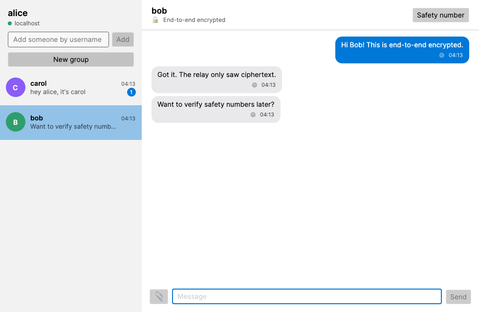
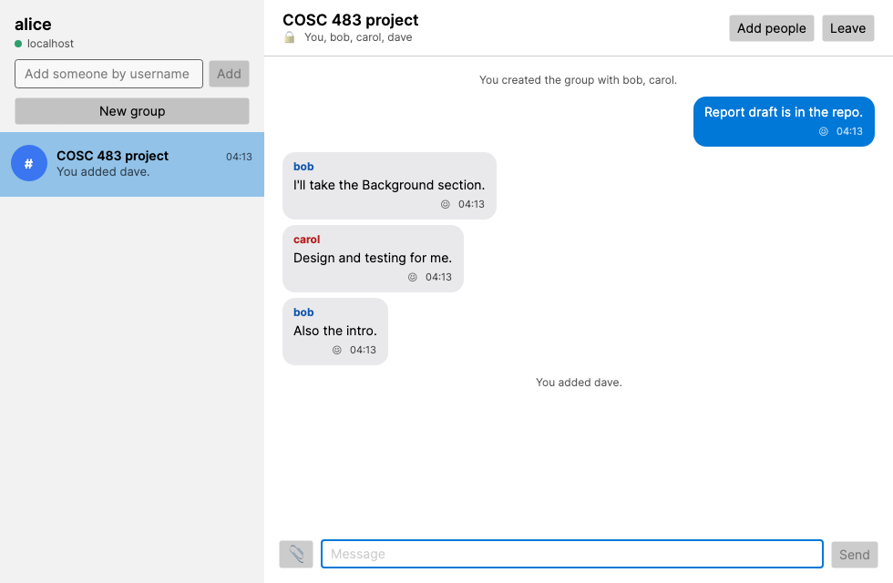
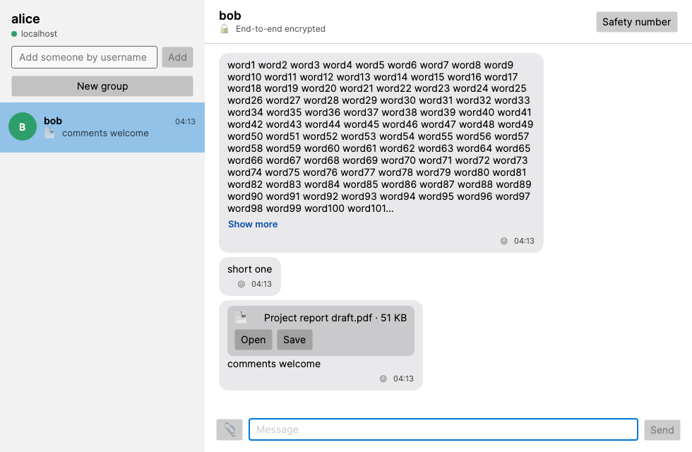
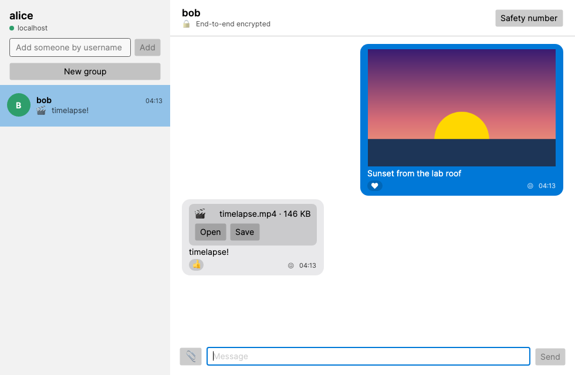

# COSC 483 Cryptographic Playground: E2EE Messenger

A Signal-style end-to-end encrypted messenger in C#, built to be a usable desktop app (macOS
and Windows). X3DH handles initial key agreement, and the Double Ratchet derives a fresh key
per message, giving forward secrecy and post-compromise security. The relay server only stores
public prekey bundles and forwards ciphertext.

Status: milestones 0–5 are done: the protocol, session layer, authenticated relay with push
delivery, CLI, and a desktop app with safety numbers and key-change warnings, plus
installable builds. Group chats, photos, videos and documents, and reactions (stretch goals) are done too. Security demos and a
usability check are next; see
[docs/STRATEGY.md](docs/STRATEGY.md).



All primitives come from vetted libraries: X25519 and Ed25519 from
[NSec](https://nsec.rocks) (libsodium), and HKDF-SHA256, HMAC-SHA256, and AES-256-GCM from
.NET's `System.Security.Cryptography`. We implement only the protocol layer.

## Layout

```
E2ee.sln
src/
  E2ee.Core/          protocol library
    Primitives.cs     library wrappers (RFC test vectors pass)
    X3dh.cs           X3DH key agreement (milestone 1)
    Ratchet.cs        Double Ratchet (milestone 2)
    SafetyNumber.cs   60-digit safety numbers for checking identities out of band
    Wire.cs           relay JSON format and request signing (shared with the server)
  E2ee.Messaging/     session layer shared by app and CLI
    Messenger.cs      identity, prekeys, contacts, sessions, groups, media, reactions, send/sync
    Media.cs          attachment and reaction types; which file types are accepted
    LocalStore.cs     encrypted local SQLite database
    MasterKeyStore.cs master key in macOS Keychain / Windows DPAPI / key file
    RelayClient.cs    signed HTTP client for the relay
  E2ee.Server/        untrusted relay: ASP.NET Core + SQLite, signed-request auth, push
  E2ee.Client/        CLI over E2ee.Messaging
  E2ee.App/           Avalonia desktop app (sign-up, contacts, chat, groups)
tests/
  E2ee.Tests/
    PrimitivesTests.cs   RFC 7748 / 8032 / 5869 known-answer tests
    ProtocolTests.cs     X3DH and Double Ratchet properties
    MessagingTests.cs    end to end: two profiles through an in-process relay
    RelayAuthTests.cs    signed requests: wrong key, stale, replayed, wrong path
    SafetyNumberTests.cs safety numbers, checked against scripts/safety_number_crosscheck.py
    GroupTests.cs        group chats: fan-out, adding, leaving, non-members refused
    MediaTests.cs        photos, videos, reactions; tampered and disguised files refused
    AppTests.cs          desktop app, rendered headlessly, against an in-process relay
  vectors/               deterministic protocol vectors we generate
docs/STRATEGY.md         plan, milestones, evaluation, roles
report/                  ACM acmart LaTeX report (sigconf)
scripts/                 package-app.sh (installable builds), package.sh (submission zips)
transcripts/             AI transcripts (zipped for submission)
```

## Setup

Requires the .NET 8 SDK (`brew install dotnet@8`, or https://dot.net).

```bash
dotnet build
dotnet test
```

## Running it

Start the relay. Use `--urls http://0.0.0.0:8000` to reach it from other machines on your
network, and put it behind HTTPS for anything beyond a LAN demo:

```bash
dotnet run --project src/E2ee.Server --urls http://127.0.0.1:8000
```

### Desktop app

Download a build from `dist/` (see [Packaging](#packaging)), or run from source:

```bash
dotnet run --project src/E2ee.App
```

The first launch asks for a username and the relay address. To try two people on one
machine, start a second copy with its own profile:

```bash
dotnet run --project src/E2ee.App -- --profile bob
```

Messages arrive instantly: the app keeps one request open on the relay, which answers when
mail arrives. Options: `--profile NAME`, `--data-dir DIR`, `--server URL` (pre-fills
sign-up), `--key-file`. The screen must be awake and unlocked when it starts; macOS gives a
locked session no display to render to.

**Safety numbers.** Open a conversation and click *Safety number*. Compare the 60 digits
with what your contact sees on their screen, in person or on a call, then click *Mark as
verified*. If a contact's identity key ever changes (they reinstalled, or someone is
impersonating them), the app shows a red *Safety number changed* bar, pauses sending, and
holds their new messages on the relay until you click *Review* and decide.

**Group chats.** Click *New group*, name it, and list the members' usernames. Each message
is encrypted separately for every member over your one-to-one sessions, so the relay never
learns the group exists. In a group, *Add people* adds members and *Leave* leaves (you keep
the history). Members can add people but can't remove anyone else.



**Photos, videos, documents, and reactions.** Click 📎 (or drop files on the chat) to send
files up to 100 MB; whatever is in the message box becomes the caption. Photos show in the
chat; videos and documents get *Open* (in your usual app) and *Save* (to Downloads).
Documents can be PDF, txt, md, csv, rtf, docx, xlsx, pptx, odt, ods, or odp. Formats that
can run code or macros when opened (old .doc/.xls/.ppt, .docm, HTML, SVG, ZIP, programs)
are refused. Click ☺ on any message to react; pick the same reaction again to take it back.

Messages can be up to 16,000 characters (send longer text as a document). Long messages
show their first few lines with *Show more*.



The files are kept on your devices, not the server. Each file is encrypted with a new
random key before it leaves your computer, and the key travels inside the end-to-end
encrypted message. The relay holds only the ciphertext, only for the people you sent it
to, and deletes it as soon as they all have it (or after 14 days). Each recipient checks
it wasn't altered, decrypts it, and keeps it in their profile's encrypted `media` folder.



### Command line

Each person uses their own profile. On one machine, two profiles stand in for two people.
Register each once (the relay URL is remembered):

```bash
dotnet run --project src/E2ee.Client -- --profile alice --server http://127.0.0.1:8000 register alice
```

```bash
dotnet run --project src/E2ee.Client -- --profile bob --server http://127.0.0.1:8000 register bob
```

Then chat from two terminals:

```bash
dotnet run --project src/E2ee.Client -- --profile alice chat bob
```

```bash
dotnet run --project src/E2ee.Client -- --profile bob chat alice
```

Groups are named with a `#`:

```bash
dotnet run --project src/E2ee.Client -- --profile alice group-create Study bob,carol
```

```bash
dotnet run --project src/E2ee.Client -- --profile bob chat "#Study"
```

Photos, videos, and reactions work from the command line too:

```bash
dotnet run --project src/E2ee.Client -- --profile alice send-file bob ~/Pictures/cat.jpg look
```

```bash
dotnet run --project src/E2ee.Client -- --profile bob react alice 👍
```

Other commands: `send`, `sync`, `history`, `add`, `contacts`, `safety`, `verify`, `trust`,
`groups`, `group-add`, `group-leave`, `save`, `whoami` (see `--help`). `send`, `history`,
`send-file`, `react`, and `save` also take a `#group`.

Profiles live in `~/Library/Application Support/E2ee/<profile>` on macOS (`%LOCALAPPDATA%\E2ee`
on Windows, `~/.local/share/E2ee` on Linux). Private keys, sessions, and message history are
encrypted with a per-profile master key kept in the macOS Keychain or Windows DPAPI; pass
`--key-file` to keep it in a file in the profile instead. The relay writes `relay.sqlite3`
(override with the `E2EE_DB` environment variable) and only ever holds public keys and
ciphertext; attachments in transit sit in `relay-attachments/` next to it.

Screenshots in `docs/screenshots/` come from the UI tests. Regenerate them with
`E2EE_SCREENSHOTS=docs/screenshots dotnet test`.

## Packaging

```bash
scripts/package-app.sh 0.5.0
```

This writes self-contained zips to `dist/`, so nobody needs .NET installed:
`E2EE-Messenger-0.5.0-macOS-arm64.zip` (Apple Silicon), `-macOS-x64.zip` (Intel),
`-Windows-x64.zip`, `-Linux-x64.zip`, and `E2EE-Relay-0.5.0.zip` (needs the .NET 8 runtime:
`dotnet E2ee.Server.dll --urls http://0.0.0.0:8000`).

The builds aren't signed with a developer certificate, so the first launch needs one
extra step:

- **macOS:** unzip by double-clicking (Finder keeps the signature intact), move
  *E2EE Messenger* to Applications, and open it. When macOS blocks it, go to System
  Settings → Privacy & Security and click *Open Anyway*.
- **Windows:** unzip, run `E2eeMessenger.exe`, and if SmartScreen appears click
  *More info* → *Run anyway*.

## Report

Build it with `cd report && latexmk -pdf main.tex`, or upload `report/` to Overleaf, which
includes `acmart`.

## Submission checklist

- [ ] `report/main.pdf` uploaded to Canvas
- [ ] artifacts zip (`scripts/package.sh`)
- [ ] `transcripts.zip`
- [ ] Canvas comment describing AI use
